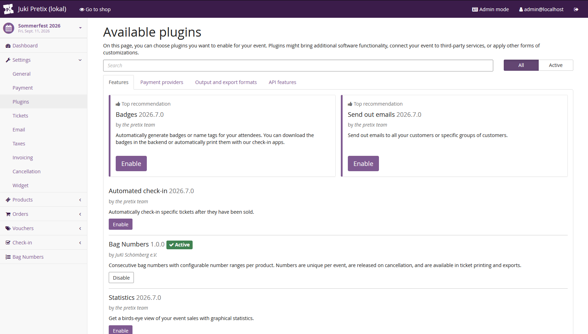
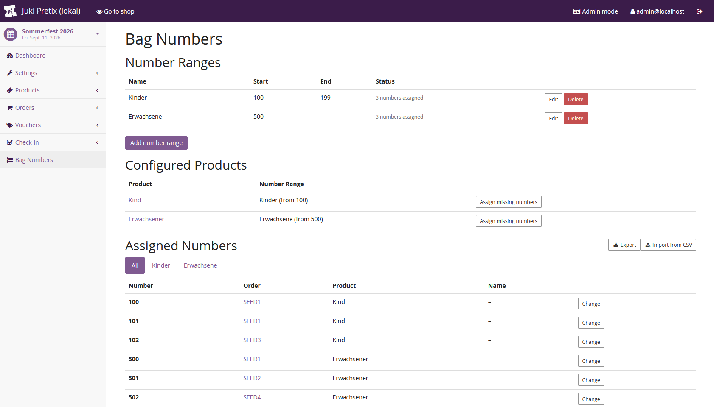
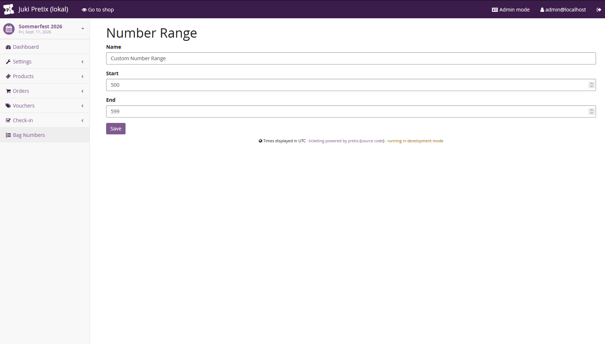
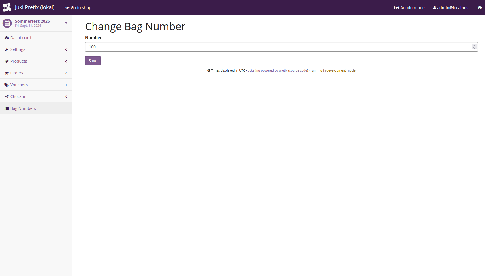
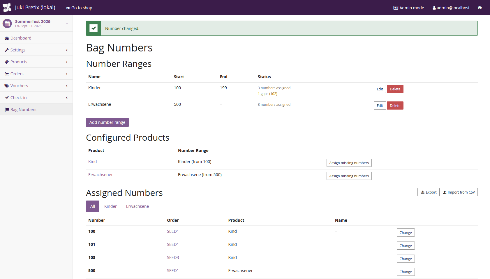
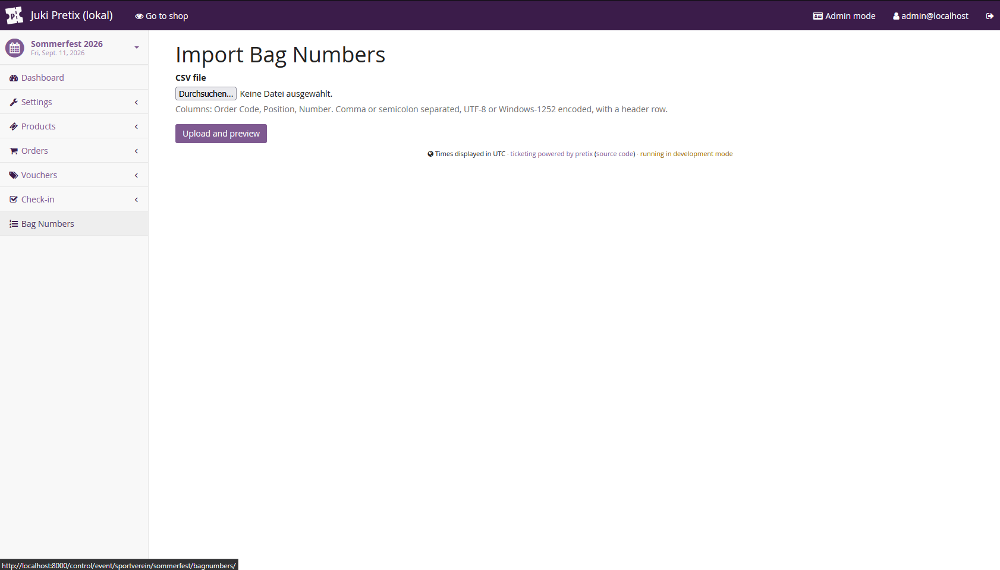
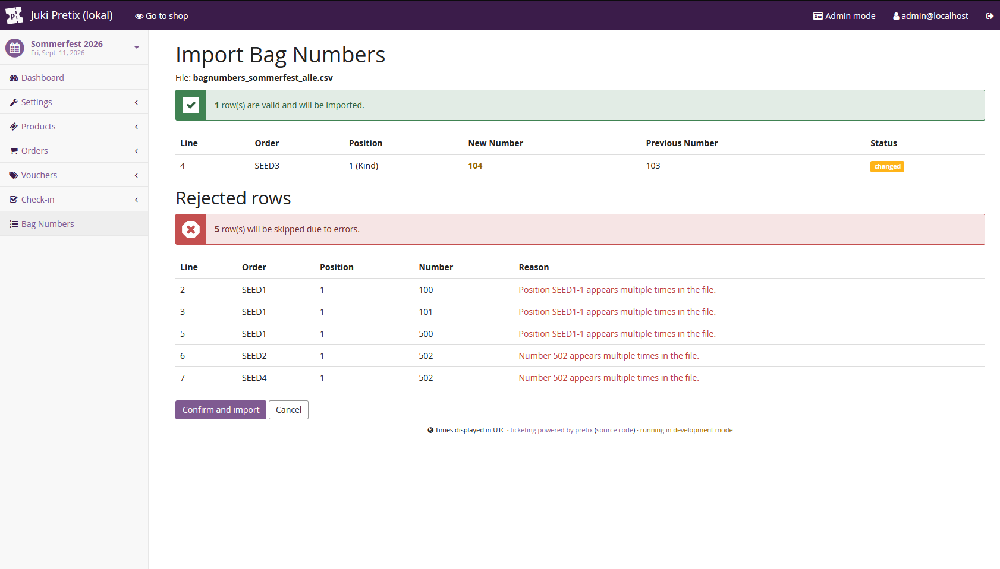
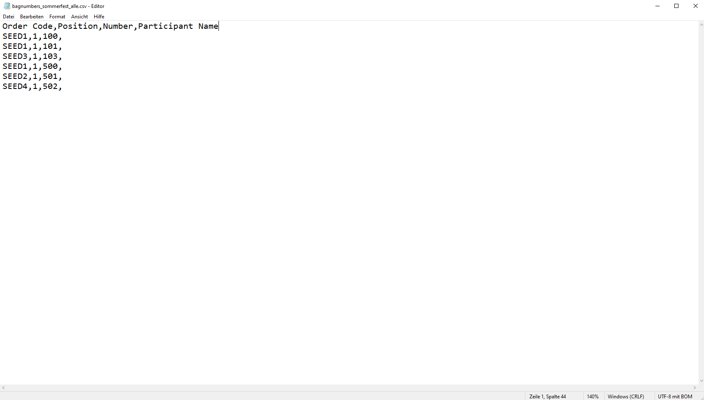
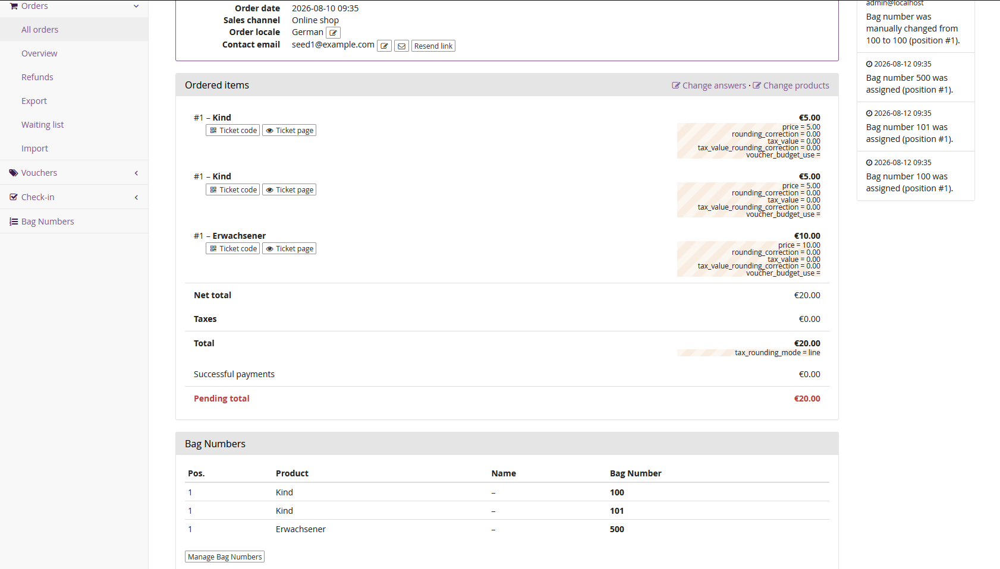
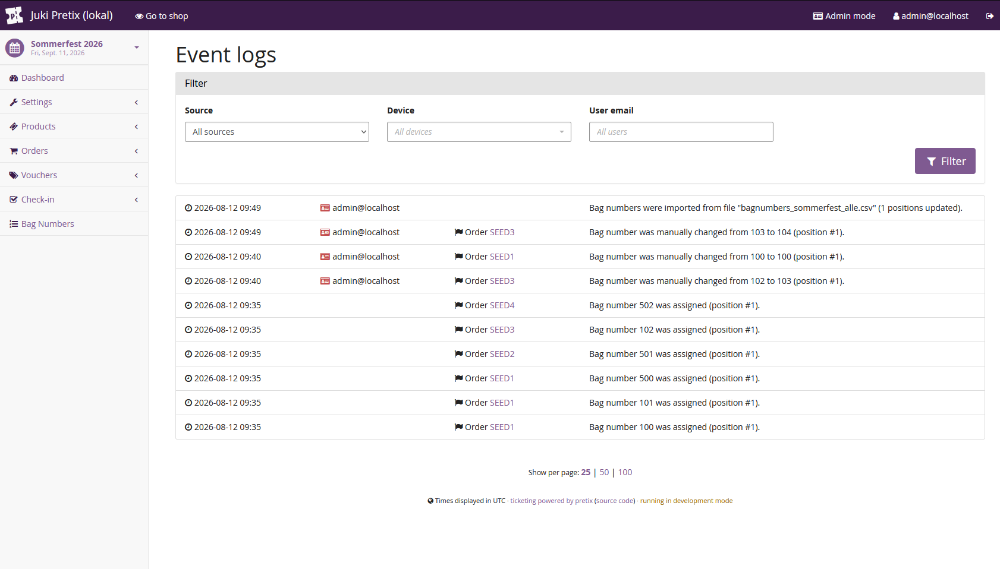

# pretix-bagnumbers

A plugin for [pretix](https://pretix.eu) that adds sequential **bag
numbers** with configurable number ranges per product, so numbered bags can
be handed out cleanly on site.

[](LICENSE)

## Screenshots

### Enable plugin in settings



### Overview over bag numbers



### Add new number range



### Change one bag number



### See changes and number gaps



### Import bag numbers



### Preview import



### Exported CSV



### See numbers in order view



### See changes in logs



## How it works

- **Number ranges** (name, start, optional end) are created per event.
  Overlapping ranges are rejected on save.
- **Assignment on the product**: the `item_forms` signal adds a "Number
  range" field to every product page. Products without an assignment don't
  receive a number.
- **Allocation** on `order_placed`: smallest free number >= start,
  race-condition-safe via `SELECT ... FOR UPDATE` on the number range plus a
  UniqueConstraint as a safety net.
- **Release on cancellation** (`order_canceled`, partial cancellation via
  `order_changed`): the number is deleted and reused on the next allocation
  (gap filling).
- **Reactivation** (`order_reactivated`): a NEW number is allocated (smallest
  free one), the old one is not restored -- it may have been taken in the
  meantime.
- **Order split** (`order_split`): new positions in the split-off order
  receive new numbers.
- **Backend**: its own top-level "Bag Numbers" entry in the event sidebar
  with an overview of number ranges, configured products (with a jump link
  to the product page), and allocated numbers including manual change (with
  duplicate check).
- **Ticket printing**: `bagnumber` ("Bag number") variable in the PDF ticket
  designer.
- **CSV export**: the "Export" button in the overview delivers a CSV
  directly (without going through the generic pretix exporter dialog) with
  Order Code, Position, Number, Participant Name -- comma-separated, UTF-8
  with BOM. Tabs above the "Assigned Numbers" table let you switch between
  "All" and individual number ranges; the export honors whichever view is
  currently selected. Deliberately no longer a registered `ListExporter`
  (previously under "1 Juki") -- participant-data exports with
  questions/invoice address/etc. are now handled by a separate plugin.
- **CSV import**: assignments (order code, position, number) can be imported
  via CSV -- comma/semicolon are auto-detected, UTF-8 and Windows-1252 are
  supported, extra columns (e.g. "Participant Name" from the export) are
  ignored. That makes the export directly reusable as an import template:
  export -> adjust numbers externally -> re-import. Two-step flow: upload
  shows a preview of the valid rows as well as all rejected rows with a
  reason (order/position not found, invalid status, no number range
  configured, number outside the range, duplicates within the file,
  collision with a position not part of the import); only an explicit
  confirmation click writes anything. On write, the old numbers of all
  affected positions are deleted first and then re-created, so swap
  scenarios (two positions trading their number) work too. Assignments not
  included in the import are left untouched; erroneous rows are skipped
  (partial import). Rows whose number doesn't actually change (e.g. when
  re-importing an unmodified export) are shown greyed out in the preview and
  are skipped entirely on write -- no delete/create, no log entry.
- **REST API**: the number appears as `bag_number` in the `plugin_details`
  field of the OrderPosition API (`orderposition_api_details` signal).
- **Event cloning**: ranges and assignments are copied along, numbers are
  not.

Signal names have been checked against the pretix docs as of 2026.7
(`layout_text_variables` and `order_reactivated` live in
`pretix.base.signals`).

## Installation (Docker)

Add this to your pretix instance's Dockerfile:

```dockerfile
RUN pip3 install pretix-bagnumbers
```

Database migrations are applied automatically the next time the instance
starts (`python -m pretix migrate` runs in the pretix entrypoint).

## Local development

```bash
pip install -e .
# a pretix environment needs to be configured:
python -m pretix migrate
```

## Tests

```bash
pip install pytest pytest-django
pytest tests/
```

## Release process

Releases are published to PyPI via a GitHub Actions workflow
(`.github/workflows/release.yml`) using
[PyPI Trusted Publishing](https://docs.pypi.org/trusted-publishers/) (OIDC,
no API token stored in the repo). To cut a release:

1. Bump `version` in `pyproject.toml` and commit.
2. Create and publish a GitHub Release (tag it, e.g. `v1.1.0`). Publishing
   the release triggers the workflow, which builds the sdist/wheel and
   uploads them to PyPI via the `pypi` environment.

The trusted publisher on PyPI is configured for this exact repository
(`juki-schoemberg/pretix-bagnumbers`), workflow (`release.yml`), and
environment (`pypi`) -- publishing only succeeds from that combination.

## Decisions made along the way

- **API performance**: 1 query per position in the
  `orderposition_api_details` receiver is acceptable for the expected event
  size -- deliberately left as is.
- **Logging**: allocation, release, and manual change create LogEntries
  (`pretix_bagnumbers.number.assigned/released/changed`) via the
  `log_entry_types` registry and show up in the order history.
- **Deleting number ranges**: the delete button only appears for empty
  ranges; a server-side guard plus `PROTECT` act as a double safety net.
- **Test mode**: `order_gracefully_delete` releases numbers immediately
  (without a log entry).
- **Check-in**: the number is printed on the ticket via the designer
  variable; no display in the check-in app is needed.
- **Assign performance**: the `used` set for gap filling is computed in
  Python across the whole event. At the expected event size (hundreds of
  numbers) this is uncritical; a DB-side gap algorithm would only become
  relevant at tens of thousands of entries.
- **CSV import -- preview buffer**: between upload and confirmation, the raw
  CSV text (not the parsed result) is kept in the session and fully
  re-validated on confirmation. This keeps the code simple and automatically
  guards against race conditions if the data changes between preview and
  confirmation.
- **CSV import -- number range validation**: unlike the manual single-number
  change (`BagNumberChangeForm`, which only checks global uniqueness), the
  import validates strictly against the start/end of the configured number
  range, to catch typos during bulk import.
- **CSV import -- logging**: per row, the existing
  `number.assigned`/`number.changed` log types are reused (same order
  history as a manual change); in addition, a new event-level log type
  `import.completed` summarizes each import run.
- **CSV export -- permission**: `can_view_orders` instead of
  `can_change_event_settings`/`can_change_orders`, since the export is
  read-only and exposes order data (order code, name).
